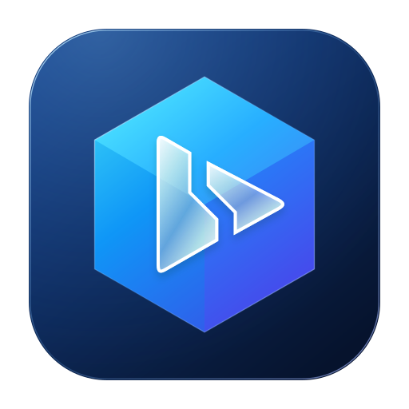

  
  

# KrPlay

**让闲置安卓设备重新上岗，把 CarPlay 带到车机屏幕上。**

[English](README.md) · 简体中文

KrPlay 在安卓手机或盒子上接收 iPhone 的 CarPlay，再把画面、声音和触控操作传递给车机上的 **KrPlay-Client**。项目面向可安装安卓应用的极氪 8295 车机，提供原生客户端和可收起的常用操作侧栏。

## 可以做什么

- 在车机大屏使用 iPhone 的 CarPlay 应用，支持触控和侧栏操作。
- 在客户端播放声音，并在 iPhone 请求时使用客户端麦克风进行 Siri 或通话输入。
- 通过已配置的系统热点或 USB 连接 iPhone；客户端自动查找接收端，也支持手动填写地址。
- 单独开启借网 VPN，让接收端使用车载网络。
- 调整画质、查看连接性能，并在排查问题时导出诊断信息。
- 接收设备具备 root 权限时，还可通过虚拟屏幕转发安卓应用。

## 两个应用，一套连接

| 应用 | 安装位置 | 基本要求 |
| --- | --- | --- |
| **KrPlay** · 绿色图标 | 闲置安卓手机或盒子 | Android 9 及以上 |
| **KrPlay-Client** · 蓝色图标 | 车机 | Android 10 及以上，且网络能够访问接收端 |

普通 CarPlay 接收、转发及可选借网 VPN 无需 root；安卓应用虚拟屏幕与触控注入需要 root。兼容性受车机固件和网络隔离影响，固定地址不能绕过车机宿主的网络限制。

## 开始使用

1. 构建并安装两端 APK。GitHub Actions 成功运行后也可提供开发版安装包。
2. 在接收设备打开 KrPlay。无线连接需先在安卓系统蓝牙设置中配对 iPhone，并在连接设置填写系统热点的准确名称和密码；也可使用 USB。
3. 让车机宿主系统连接接收设备热点，再打开 KrPlay-Client。自动查找失败时，填写 KrPlay 显示的可达地址。
4. 需要 Siri 或通话输入时，授予客户端麦克风权限。借网需单独开启；出现安卓 VPN 授权提示时按需允许。

公开源码构建**不含 CarPlay 认证材料**。实际使用 CarPlay 需要另行取得有权使用的认证材料，并进行私人本地构建，未经配置的 APK 无法直接完成 CarPlay 认证。

借网目前支持 TCP 和 DNS，尚不支持通用 UDP/QUIC；安卓系统同一时间只能运行一个 VPN。

## 项目与致谢

KrPlay 基于 [wheelplay](https://github.com/fython/wheelplay)、[DiPlay](https://github.com/shihabal3amri/DiPlay) 和 [xcertplay](https://github.com/shilapi/xcertplay)。感谢上游作者与所用开源组件的贡献，固定版本见[来源记录](docs/upstream-sources.json)。

仓库保留 GPL-3.0 代码及 AGPL-3.0 界面组件；第三方资源适用各自条款。详见 [LICENSE](LICENSE) 与 [第三方声明](THIRD_PARTY_NOTICES.md)。CarPlay、Apple、Zeekr 名称和商标属于各自权利人。本项目独立开发，不代表官方认可或认证。

分发 APK 时必须同时提供对应版本源码、版权与许可文本，具体流程见[二进制与源码分发说明](DISTRIBUTION.md)。
